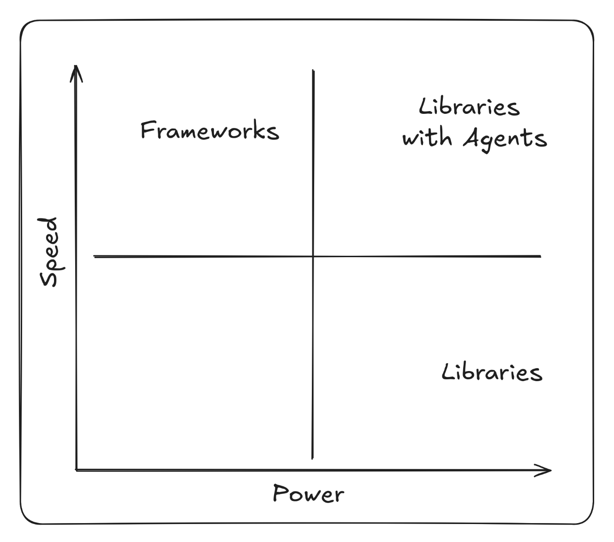
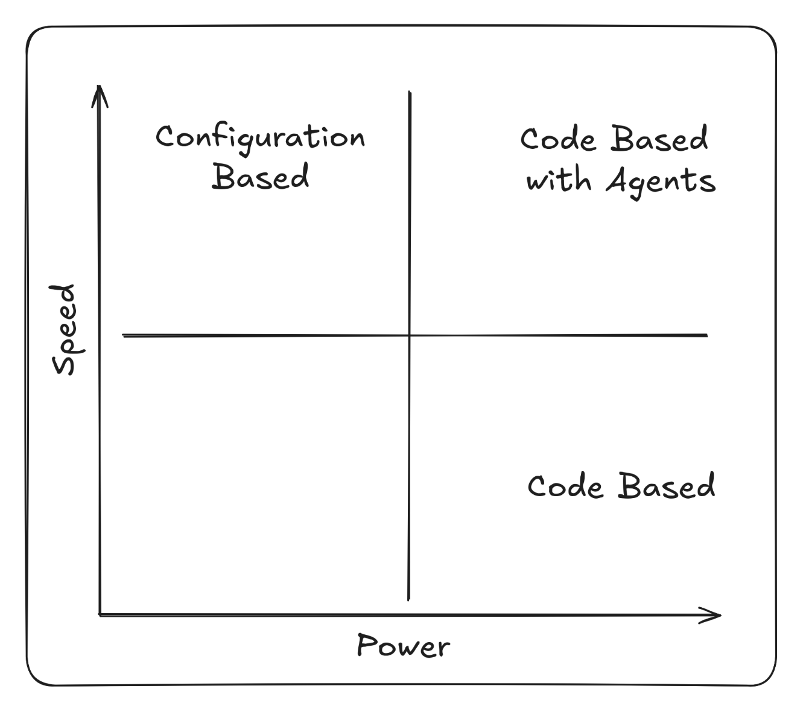
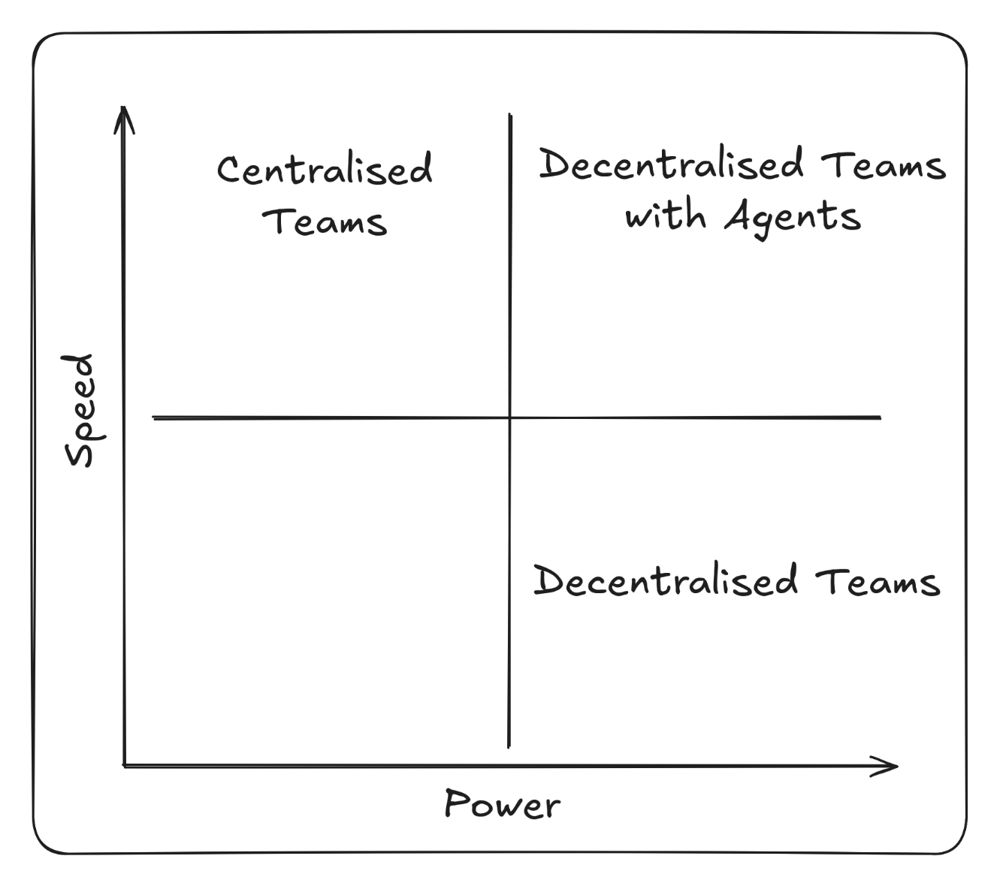

Agentic coding marks a decisive shift in software development towards decentralisation and empowered teams across three layers: code, architecture, and team topology. As coding agents take on more responsibility, they transform not only how code is written but how systems are structured and how teams collaborate.

## 1. Code

At the code level, agentic coding replaces procedural control with intent-driven collaboration. Developers increasingly express goals, constraints, and patterns of reasoning, while autonomous coding agents interpret and act on these prompts.

As developers adapt to this new approach the focus increasingly becomes around writing concise specifications. Instead of working line-by-line, developers use specifications to orchestrate AI agents that:

- Generate and refactor code according to localised patterns and style rules.
- Rely on inbuilt tooling and pipelines to enforce coding standards and preferences.
- Review implementations based on industry best practice for non-functional requirements (e.g security and performance).

As agents become responsible for generating code and humans become responsible for writing the specification, the code becomes an artifact. The specifications, guardrails and tooling built into the repository are the inputs into the LLM which produces the code. Similar to the way a compiler produces machine code from source-code, albeit less deterministic.

Working with non-deterministic outputs from an LLM can be difficult, but using the specification it is possible to verify that the source-code generated meets the original requirements either through testing or using other LLMs for verification.

As generating code becomes "cheap", the code becomes a disposable artifact that can easily be regenerated. That changes the balance of trade-offs that have long been discussed in the industry.

### Frameworks vs Libraries

Discussion around using a library vs a framework goes back to as early as 2005 when Martin Fowler wrote in his post about [Inversion of Control](https://martinfowler.com/bliki/InversionOfControl.html):

> "Inversion of Control is a key part of what makes a framework different to a library. A library is essentially a set of functions that you can call, these days usually organized into classes…
>
> A framework embodies some abstract design, with more behavior built in. In order to use it you need to insert your behavior into various places in the framework either by subclassing or by plugging in your own classes. The framework's code then calls your code at these points."

Martin Fowler doesn't express a preference for libraries or frameworks in his post but the debate quickly grew. David Heinemeier Hansson's [Ruby on Rails Doctrine](https://rubyonrails.org/doctrine) supporting frameworks and Adrian Holovaty of Django [cautioning against frameworks](https://www.youtube.com/watch?v=VvOsegaN9Wk).

Over time it's become clear that there are trade-offs to both:

- **Frameworks** offer speed and ease of use but become restrictive and can quickly become a form of vendor lock in.
- **Libraries** offer more power and flexibility but require more set up and wiring from the developer.

This can also be framed as **Speed vs Power**.

Agentic coding changes this trade-off by increasing the speed of development when using libraries. The initial cost of set up when composing libraries is offset by using a coding agent to do the work. Given access to curated collections of libraries or components through an MCP server, agents can correctly assemble individual components efficiently.

{: .img-responsive }

That's not to say that agents don't work well with frameworks, the strict guardrails often help, but they do not solve the fundamental downsides of a framework. Using agents with libraries allows you to have the power and flexibility libraries already bring, but the speed and ease of use that is typically associated with frameworks.

## 2. Architecture

Large organisations tend to follow one of two philosophies when designing their macro-architecture: Configuration Driven or Code Driven. The choice often comes down to how best to achieve re-use across different services in the organisation.

### Configuration Driven Architecture

The Configuration Driven (or Low Code) architectural approach opts for feature-rich centralised services that provide a lot of reusable functionality but require lots of configuration. The premise is that you can write the functionality that lots of services need in one place, allowing other services to re-use it by providing a configuration.

Over time Configuration Driven Architecture often falls prey to the [Inner-platform effect](https://en.wikipedia.org/wiki/Inner-platform_effect) where the configuration becomes increasingly complex in order to support all the requirements of the users as the system evolves.

There are parallels between Configuration Driven Architecture and frameworks. Configuration can allow you to move quickly if you paint within the lines, but it quickly becomes difficult if you want to paint outside them.

The complexity of the configuration quickly grows as the system matures and custom DSLs or configuration languages often become necessary. You then face a form of vendor lock-in where developers are forced to learn organisation specific tooling, rather than industry-wide programming languages and libraries.

### Code Driven Architecture

Code Driven Architecture is a more engineering led approach where there are centralised services but as with using libraries, the services are just reusable functionality to be called upon by consuming services via API call. The set up and orchestration are done by the consumer, which comes at a cost but also allows a greater degree of flexibility and autonomy.

As Martin Fowler's 2014 page on [Microservices](https://martinfowler.com/articles/microservices.html) states that "The microservice community favours an alternative approach: smart endpoints and dumb pipe", similarly, Sam Newman's book [Building Microservices](https://samnewman.io/books/building_microservices_2nd_edition/) warns against heavily centralised architectures: "Avoid approaches like enterprise service bus or orchestration systems, which can lead to centralization of business logic".

As with libraries and frameworks, the trade-off is **Speed vs Power**. Configuration Driven Architecture promising speed and Code Driven Architecture power and flexibility.

Using agentic coding we can again adjust that trade-off. Teams are able to quickly compose reusable pieces of architecture in a way that works for them and mitigate the high set up cost without the constraints of a custom DSL or configuration language.

Common patterns and approaches from across the organisation can be distilled into `AGENTS.md` guidance, centralised prompt libraries or even dedicated sub-agents to call upon, all making it easier for the agent to build services in a way that is compatible with the ecosystem it is living in. Artifacts like ADRs stored in other codebases are invaluable resources to help agents understand the historical decision making that has led to the organisation's current approach.

So instead of large, centralised orchestration layers, intelligence moves closer to the edge:

- Systems are composed of smaller, self-sufficient services that encapsulate their own decision-making and processing logic.
- Configuration-heavy or low-code abstractions give way to clear, composable components that can evolve independently.
- Shared libraries and infrastructure still provide coherence, but not command. They serve as enablers, not bottlenecks.

This decentralisation empowers individual service teams to innovate rapidly without waiting on central gatekeepers. Architecture becomes a distributed ecosystem where composability replaces centralisation, and agility replaces dependency.

{: .img-responsive }

## 3. Team Topology

Centralising functionality behind configuration based services comes with another drawback: the teams that run the centralised services quickly become a bottleneck, as the aggregates all of the demand for new features from every one of their consumers.

Martin Skelton and Manuel Pais' book [Team Topologies](https://www.amazon.co.uk/Team-Topologies-Organizing-Business-Technology/dp/1942788819) outlines the problems in terms of value-stream alignment. If the delivery teams are not empowered to deliver value for their users or stakeholders, their requirements are pushed on to the team that can deliver it. This results in complex cross-team coordination for developing and releasing functionality.

In essence, it's important not to confuse the technical platform that developers use to build their solution with the solution itself. As Martin and Manuel state:

> "The most important part of the platform is that it is built for developers."

Agentic coding reshapes team topology from centralised delivery functions into value-stream-aligned teams where value is delivered "at the edge". No longer dependent on a central platform or integration groups to deliver functionality, teams own the full lifecycle of their services.

- Teams align around products or domains rather than technical specialisms.
- Dependencies on centralised delivery teams are reduced as teams become more autonomous.
- Engineers operate within cross-functional squads that combine development, testing, and deployment capabilities, supported—not controlled—by platform services.

This value-stream alignment mirrors the autonomy seen in the code and architecture layers. Teams become self-contained, adaptive units capable of shaping their own pipelines and responding directly to user needs.

{: .img-responsive }

Ultimately [Conway's Law](https://en.wikipedia.org/wiki/Conway%27s_law) takes effect and the organisation decentralises to the same degree as its software.

## The Emerging Pattern: Empowerment Through Decentralisation

The common thread through all these layers is decentralisation and empowerment "at the edge". As agentic coding is introduced at the very bottom of the stack, the ramifications rise to the top. Developers and development teams become more empowered to deliver functionality unencumbered by centralised systems holding them back, and they do it with the speed and ease of use typically offered by the centralised systems.

The rise of agentic coding (or vibe coding) has generated lots of debate within the industry and opinion is split on whether it's a net negative or positive. Proponents argue that there are massive productivity gains when using agentic coding, but opponents argue that there are risks around security, code quality and governance. What both sides agree on is that agents can generate a lot of code, and they can do it quickly.

As the industry matures it's becoming clearer that the risks can be mitigated with appropriate guardrails and tooling. It takes time to distill and embed the organisational knowledge, practices and engineering standards but doing so not only makes developers more productive, but also allows organisations to move from centralised control to empowered, autonomous teams.
